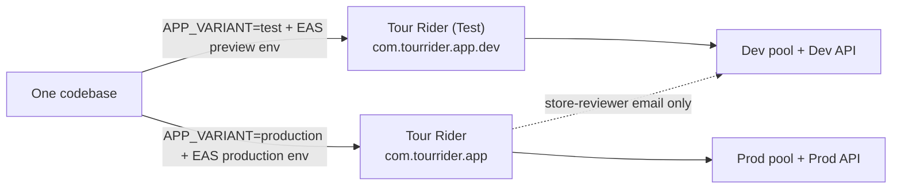
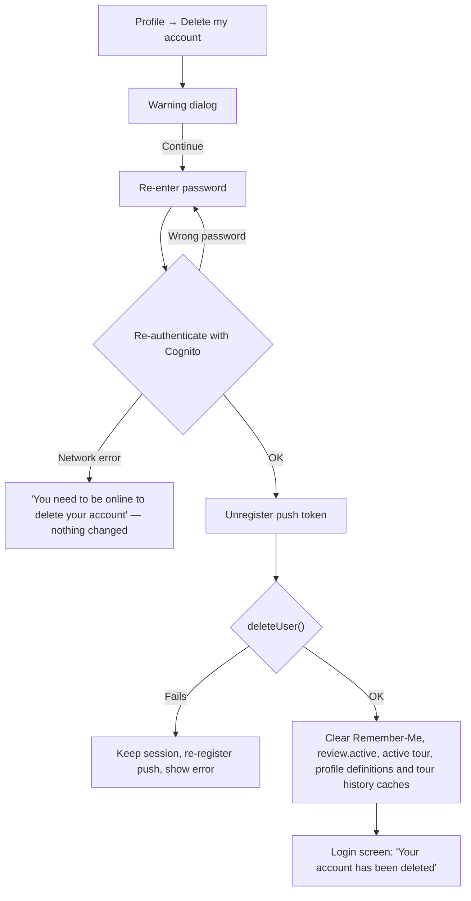

# App variants and environments (Test / Production)

_Last updated: 2026-11-20_

Status: **Approved — implemented in tour-rider-app** (tour-mgmt-app follows the same design separately).

## 1. Problem and approach

Testers are real riders and organisers who use the **same email** in test and in production. If the backend were chosen at runtime (a hidden "test mode" or routing by email), a tester could forget to switch and change live tour data. That risk is not acceptable.

The design uses **one codebase that builds two separate store apps**. The Test app can only reach the Dev backend. The Production app reaches the Prod backend, except for the one store-reviewer account. Which backend you use depends on which app icon you tap, never on a setting you might forget.

## 2. Identifiers

| App | Variant | Bundle ID / package | Display name | URL scheme | Backend |
|---|---|---|---|---|---|
| tour-rider-app | Production | `com.tourrider.app` | Tour Rider | `tour-rider-app` | Prod; store-reviewer email → Dev |
| tour-rider-app | Test | `com.tourrider.app.dev` | Tour Rider (Test) | `tour-rider-app-dev` | Dev only (review routing off) |
| tour-mgmt-app | Production | `com.tourmgmt.app` | Tour Mgmt | `tour-mgmt-app` | Prod; store-reviewer username → Dev |
| tour-mgmt-app | Test | `com.tourmgmt.app.dev` | Tour Mgmt (Test) | `tour-mgmt-app-dev` | Dev only |

Both variants of an app can be installed side by side on the same device. They have different icons: the Test icon carries a "TEST" ribbon.

## 3. Decisions

| # | Decision |
|---|---|
| D1 | Two store apps per product (Test and Production), built from one codebase. The variant is chosen at build time by `APP_VARIANT` (`test` \| `production`, default `production`). |
| D2 | Build values come **only from EAS environment variables**: the `preview` environment holds Test (Dev) values and the `production` environment holds Prod values. No `.env` files are committed; `.env.example` lists variable names only. |
| D3 | tour-mgmt-app: sharing the Dev pool between testers and the reviewer is acceptable. |
| D4 | The store reviewer is **admin-created in the Dev pool**. The Production app routes that exact email to Dev, which keeps the reviewer out of Prod data. |
| D5 | tour-rider-app: sign-up and password reset **always use the primary pool**. The Review pool is only used when the reviewer signs in. |
| D6 | Rider testers sign themselves up in the Dev pool using the Test app. The same email can exist in Dev and Prod as two independent Cognito users. |
| D7 | Fresh App Store Connect and Play Console records are created for **all four identifiers**. |
| D8 | iOS testers use **TestFlight external testing**. Ad hoc builds are for emergencies only. |
| D9 | Store builds only. **OTA updates (EAS Update) are deferred**: there is no `updates.url` and no `expo-updates`. The `channel` values in `eas.json` are reserved for later. |
| D10 | Dev and unit testing are unchanged (`npm start`, local `.env`, Jest). |
| D11 | Each Android package has its **own Firebase Android app and FCM credentials** (`google-services.json` per package, stored as an EAS file variable). The **APNs key is shared** across the team's iOS apps. |
| D12 | **Delete my account** deletes the Cognito user only. Backend data (profile, enrolments, check-ins) is untouched; backend PII deletion is a follow-up in tour-data-api. |
| D13 | Before the Production app goes live on Google Play, run a **closed test with at least 12 testers for 14 days against Prod**, apply for production access, then clean the test data out of Prod. |

## 4. Store compliance

**Apple**

- **2.1 App completeness:** give App Review a working demo account in the review notes. This is the reviewer email, which exists only in the Dev pool. Re-create it if it has been deleted.
- **5.1.1(v) Account deletion:** apps that allow account creation must let users start account deletion in the app. This is provided by Profile → **Delete my account** (§8).
- **TestFlight** builds expire after **90 days**. External groups need **Beta App Review** for the first build of each version.

**Google Play**

- **Internal testing:** up to 100 testers, available without review, used for the Test app.
- **Data safety:** declare account deletion and provide a **web link** where users can request account deletion. The in-app action alone is not enough.
- **Personal developer accounts** created after November 2023 must run a **closed test with at least 12 opted-in testers for 14 continuous days** before they can apply for production access (D13).

## 5. Build configuration

| File | Role |
|---|---|
| `app.json` | Static config: `owner`, `slug`, `version`, `runtimeVersion` (`appVersion` policy), plugins, `extra.eas.projectId` (placeholder `<EAS_PROJECT_ID>` until `eas init`). There are no bundle IDs and no `updates.url`. |
| `app.config.ts` | Reads `APP_VARIANT` and sets `name`, `scheme`, `icon`, `ios.bundleIdentifier`, `android.package`, the adaptive icon, `android.googleServicesFile` (only when `GOOGLE_SERVICES_JSON` is set) and `extra.appVariant`. |
| `eas.json` | Build profiles `development`, `test`, `adhoc` (extends `test`, internal distribution) and `production`. Each profile sets `APP_VARIANT` and the profile-managed flags, and selects the EAS environment. Submit profiles `test` (Play internal track) and `production` (Play alpha/closed track). |
| `.github/workflows/deploy.yml` | Manual GitHub Actions workflow. `develop` builds the Test app, `main` the Production app; any other branch fails. It checks the code, reads the backend values from SSM, syncs the EAS environment, then starts the EAS build with optional `--auto-submit`. |
| `tools/backend-config.mjs` | Makes an EAS environment match tour-data-api's SSM handover (`/tour-data-api/<env>/rider/*`). It writes only changed variables, separates variables shared between environments, refuses `preview` writes outside `develop` and `production` writes outside `main`, and supports `--dry-run`. |

### EAS environment variable matrix

| Variable | `preview` (Test) | `production` |
|---|---|---|
| `EXPO_PUBLIC_AWS_REGION`, `EXPO_PUBLIC_AWS_USER_POOL_ID`, `EXPO_PUBLIC_AWS_USER_POOL_WEB_CLIENT_ID` | Dev | Prod |
| `EXPO_PUBLIC_TOUR_DATA_API_BASE_URL` | Dev | Prod |
| `EXPO_PUBLIC_AWS_IDENTITY_POOL_ID` | not set (the backend has no identity pool) | not set |
| `EXPO_PUBLIC_REVIEW_USERNAME` | not set | reviewer email (GitHub variable `REVIEW_USERNAME`) |
| `EXPO_PUBLIC_REVIEW_AWS_*`, `EXPO_PUBLIC_REVIEW_TOUR_DATA_API_BASE_URL` | not set | Dev |
| `GOOGLE_SERVICES_JSON` (file, secret) | `.dev` Firebase file | prod Firebase file |

The deploy workflow writes every row except `GOOGLE_SERVICES_JSON` from tour-data-api's SSM handover on each run. `APP_VARIANT`, `EXPO_PUBLIC_SUBSCRIPTION_MODE`, `EXPO_PUBLIC_LOG_LEVEL`, `EXPO_PUBLIC_API_DEBUG_GET` and, when used, `EXPO_PUBLIC_ORGANIZER_ID` and `EXPO_PUBLIC_ORGANIZER_NAME` are set by the `eas.json` profile, not the EAS environment. `EXPO_PUBLIC_*` values are embedded in the binary. They are public identifiers, **never secrets**.

## 6. Runtime routing

`src/config/reviewAccess.ts` mirrors tour-mgmt-app. At startup `initBackendRouting()` remembers the primary profile from `subscriptionConfig.organizer`. Routing is **disabled (fail-safe)** if the reviewer username, the Review pool, client or API URL is empty. That is always the case in the Test app.

| Action | Backend used |
|---|---|
| `login(email)` / `completeNewPasswordChallenge` | `routeBackendForLogin(email)` runs before sign-in. An exact, case-insensitive reviewer match applies the Review profile (`configureAmplifyForOrganizer` + `setApiBaseUrl`); anyone else gets the primary profile. It reconfigures only when the profile actually changes. |
| Successful reviewer sign-in | `review.active` is saved in SecureStore. |
| App start with a stored session | If `review.active` is set, the Review profile is applied **before** reading the session (`getCurrentUser` / `fetchAuthSession`). |
| `signUp`, `confirmSignUp`, `resetPassword`, `confirmResetPassword` | `routeBackendToPrimary()` runs first. |
| `logout` | Unregister push → `signOut` → clear `review.active` → primary. |
| `UserAlreadyAuthenticatedException` during sign-in | Sign out and retry once. |

`apiClient` keeps its module-level initialisation from the subscription config. `setApiBaseUrl()` / `getApiBaseUrl()` allow runtime changes.

## 7. TEST banner

`TestVariantBanner` wraps the app. When `Constants.expoConfig.extra.appVariant === 'test'` it shows a persistent, high-contrast **TEST** strip in the top safe area above every screen. Screens are laid out below it through a nested `SafeAreaProvider`. The strip is announced by screen readers. Production builds, including reviewer sessions, show no banner. At startup the app logs the variant and API host at INFO level.

## 8. Delete my account

- Re-authentication calls Cognito `InitiateAuth` (`USER_PASSWORD_AUTH`) against the **active** pool from `Amplify.getConfig()`. The current Amplify session is left alone and the returned refresh token is revoked straight away. This call is also the online check: if it cannot reach Cognito, nothing happens.
- Only the Cognito user is deleted. **Backend data is not changed** (D12).
- A reviewer who deletes the account deletes the Dev reviewer user. Re-create it before the next submission.

## 9. Release process

1. Build and submit the Test app: run the **Deploy** workflow on `develop`. Testers receive it through TestFlight external groups and the Play internal track, and test against Dev.
2. When testing is done, merge `develop` to `main` and run the **Deploy** workflow on `main`. It goes to TestFlight and the Play closed (alpha) track.
3. Before the first go-live: run the Play closed test against Prod (12 testers × 14 days), apply for production access, then clean up Prod (D13).
4. Submit the Production app for review with the Dev reviewer credentials, then release manually.

The workflow setup and steps are in the [deployment guide](../guides/deployment.md); store, credential and tester steps are in the [EAS build and release guide](../guides/eas-build-and-release.md).

## 10. Risks

| Risk | Mitigation |
|---|---|
| Tester uses the Production app by mistake | Different name, icon and TEST banner; the Test app cannot reach Prod. |
| Wrong values in an EAS environment | The deploy workflow syncs them from SSM before every build and verifies the result; the run summary lists each variable's action. The startup log shows the API host. |
| Dev build writes Prod values, or the reverse | The workflow maps `develop` → `preview` and `main` → `production`, and `tools/backend-config.mjs` refuses any other combination. The prod read role trusts `main` only. |
| Reviewer routing points at Prod | Review variables are Dev-only and exist only in the `production` environment. |
| Reviewer account deleted or expired | Release checklist: re-create the reviewer before each submission. |
| TestFlight build expires (90 days) | Rebuild the Test app at least every 90 days. |
| Backend PII remains after account deletion | Tracked as a tour-data-api follow-up; the Data safety web link handles requests meanwhile. |
| Push to the wrong app | Separate FCM per package; push tokens register with the backend the app is using. |
| Missing projectId or placeholder IDs | `eas init` replaces `<EAS_PROJECT_ID>`; push registration skips placeholder IDs. |

## 11. Implementation plan

1. EAS project setup: `app.json`, `eas.json`, `.env.example`. ✅
    - Deploy workflow with EAS sync from the SSM handover (`.github/workflows/deploy.yml`, `tools/backend-config.mjs`). ✅ Dev run pending; prod pending the production AWS account.
2. `app.config.ts` and placeholder Test icons (`assets/icon-test.png`, `assets/adaptive-icon-test.png`). Replace them with "TEST" ribbon art. ✅ (art pending)
3. Store-reviewer routing and `AuthContext` wiring. ✅
4. TEST banner and startup logging. ✅
5. Delete my account plus unit tests. ✅
6. Operator steps: `eas init`, store records, credentials, EAS env vars, first builds (see the guide). ⏳
7. Follow-up: backend PII deletion in tour-data-api and a web deletion-request page. ⏳
