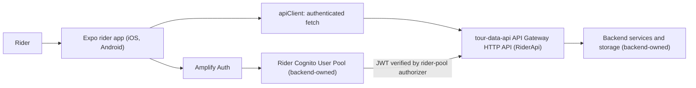
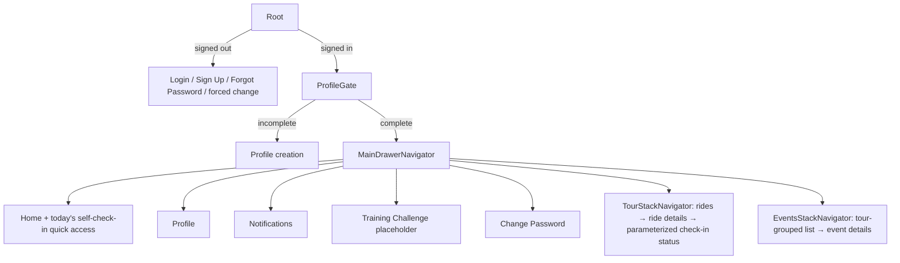

# Rider app architecture

_Last updated: 2026-10-01_

The Expo/React Native app targets iOS and Android; it has no supported Rider web client. Amplify Auth handles sign-in to the rider Cognito User Pool owned and managed by [tour-data-api](https://github.com/kvijay77-in/tour-data-api/blob/main/docs/guides/deployment.md). The app calls the tour-data-api API Gateway HTTP API (**RiderApi**) through `src/services/api/apiClient.ts`, with a rider-pool JWT authorizer. The backend owns AWS infrastructure, contracts and permissions; see its [API reference](https://github.com/kvijay77-in/tour-data-api/blob/main/docs/design/api-reference.md) and [RBAC source](https://github.com/kvijay77-in/tour-data-api/blob/main/src/layers/common/rbac.py). Rider check-in presentation interprets backend-resolved ride `selfService` and record metadata; it does not duplicate authorization or persist action eligibility locally.

`RootNavigator` selects `AuthNavigator` or `AppNavigator`. `AppNavigator` provides `RiderContext`, `TourContext`, and `NotificationContext` around a profile gate and `MainDrawerNavigator`. The active drawer contains Home, View Profile, Notifications, Training Challenge, Tour, Events, and Change Password; `TourStackNavigator` contains TourRides, RideDetails, and the parameterized CheckInStatus screen, while `EventsStackNavigator` contains the event list and event details. Home and CheckInStatus reuse `SelfCheckInPanel` for today's ride. `MainNavigator` is a legacy bottom-tab implementation **not used** by the active root. The tour registration/dashboard screens remain unmounted.

Context providers own session, rider profile, active tour and inbox state; hooks in `src/hooks/` expose them to screens. Services in `src/services/api/` use the shared API client for authenticated requests and errors. SQLite stores limited profile definitions and active/historical tour snapshots; this is caching, **not an offline feature**. Screens refresh from the server as appropriate. See [profile schema](profile-schema.md) and [notifications](notifications.md).

The Tour screen resolves rider participation from the profile tour endpoint and lazily caches check-in history only for the current session, keyed by tour and ride number. Pull-to-refresh clears that history cache. The Rider API's 404/empty history result is rendered as unavailable data, while unexpected API failures remain errors. `SelfCheckInPanel` does not use that ride cache for eligibility: on focus it fetches `/rides/today` and the caller's ride-number history, requires an active enrolled tour, and interprets only the returned `selfService` policy and live ride/stage state. Each mutation refreshes both the panel and, when mounted in CheckInStatus, its timeline. Quit Riding cannot be cancelled by the rider; the confirmation calls out organizer safety follow-up.

The Events stack lists events for the rider's tours, with the active tour first. Event details load definitions, occurrences, caller-aware bootstrap, and rider progress. Bootstrap supplies registration and resolved activity self-service permissions for future planned/active occurrences; progress supplies record IDs, status/method, and registration state for occurrences outside that window. The client does not resolve permission inheritance or sequence/prerequisite policy. Event registration is limited to planned occurrences; participation controls require an active occurrence and the returned backend permission. Baggage custody and reconciliation remain staff-only.

`DocumentsSection` is reused by the selected Tour view and Ride Details. It requests the scope-specific artifact manifest, hides itself after an empty/404 result, and shows load/transfer errors. It strips presigned URLs from display state and obtains a fresh one-item manifest only when opening a document. SDK 57 FileSystem downloads to app-private document storage with progress; Expo Sharing opens the local file through the platform sheet without requesting external-storage permission. A failed download refreshes the manifest and retries once.

Home and Training Challenge use `useTourArtifactImages` for the active tour's `ride-plan` and `training-challenge` images; Tour displays the selected tour's `tour-elevation` above its rides. Inline images keep presigned URLs only in focused-screen memory, refresh on focus or tour changes, and retry a failed image once with a fresh filtered manifest. URLs are cleared on blur and are never persisted. See [artifacts](artifacts.md).
