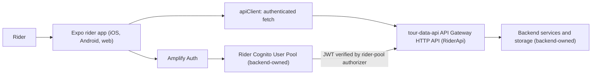
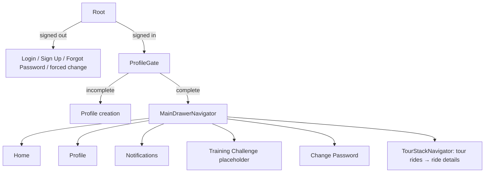

# Rider app architecture

_Last updated: 2026-09-29_

The Expo/React Native app runs on iOS, Android and web. Amplify Auth handles sign-in to the rider Cognito User Pool owned and managed by [tour-data-api](https://github.com/kvijay77-in/tour-data-api/blob/main/docs/guides/deployment.md). The app calls the tour-data-api API Gateway HTTP API (**RiderApi**) through `src/services/api/apiClient.ts`, with a rider-pool JWT authorizer. The backend owns AWS infrastructure, contracts and permissions; see its [API reference](https://github.com/kvijay77-in/tour-data-api/blob/main/docs/design/api-reference.md) and [RBAC source](https://github.com/kvijay77-in/tour-data-api/blob/main/src/layers/common/rbac.py).

`RootNavigator` selects `AuthNavigator` or `AppNavigator`. `AppNavigator` provides `RiderContext`, `TourContext`, and `NotificationContext` around a profile gate and `MainDrawerNavigator`. The active drawer contains Home, View Profile, Notifications, Training Challenge, Tour, and Change Password; `TourStackNavigator` contains TourRides and RideDetails. `MainNavigator` is a legacy bottom-tab implementation **not used** by the active root. The tour browse/details/registration/dashboard and check-in screens are present in source but not mounted.

Context providers own session, rider profile, active tour and inbox state; hooks in `src/hooks/` expose them to screens. Services in `src/services/api/` use the shared API client for authenticated requests and errors. SQLite stores limited profile definitions and active/historical tour snapshots; this is caching, **not an offline feature**. Screens refresh from the server as appropriate. See [profile schema](profile-schema.md) and [notifications](notifications.md).
