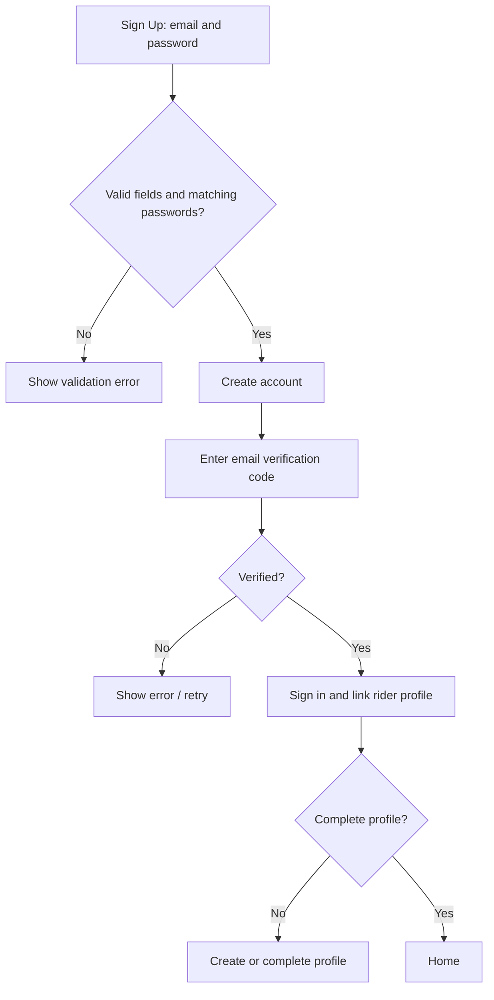
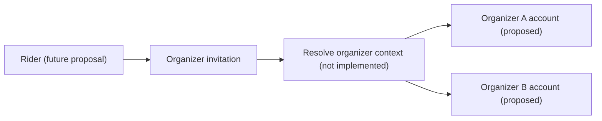

# Authentication and sign-up design

_Last updated: 2026-09-30_

`AuthContext` uses Amplify Auth with the backend-owned rider pool. In the default single-organizer build, `src/config/subscription.config.ts` reads the configured pool and API endpoint at startup. `AuthNavigator` exposes Login, Sign Up, Forgot Password and Enforced Password Change. Sign-up validates email and password, confirms the email code, then links an existing profile if possible; `AppNavigator` routes missing/incomplete profiles to Profile Creation.

## Backend routing

The Test app talks only to the Dev pool and API. The Production app talks to Prod, except that the configured store-reviewer email is routed to the Review (Dev) profile by `src/config/reviewAccess.ts`. Routing happens before sign-in, and a `review.active` flag lets the app restore the reviewer session on the next start. Sign-up, confirmation and password reset always use the primary pool. Routing is off unless every `EXPO_PUBLIC_REVIEW_*` value it needs is set. See [App variants and environments](app-variants-and-environments.md#6-runtime-routing).

## Password flows

On login, a forced new-password challenge opens the enforced change screen; the forgotten-password flow requests a code and confirms a new password. Signed-in riders use Change Password for a voluntary change. Credentials and pool settings must never be hardcoded in documentation or source. The backend [deployment guide](https://github.com/kvijay77-in/tour-data-api/blob/main/docs/guides/deployment.md) owns pool setup.

## Delete my account

Profile → **Delete my account** shows a warning and asks for the password again. The app re-authenticates against the active Cognito pool; if it cannot reach Cognito, it shows "You need to be online to delete your account" and does nothing. It then unregisters the push token and calls Amplify `deleteUser()`. Afterwards it clears Remember-Me credentials, `review.active` and the local tour and profile-definition caches, and returns to Login with "Your account has been deleted". If deletion fails, the session is kept and the error is shown. Only the Cognito user is deleted; backend rider data is not changed. See [the flow](app-variants-and-environments.md#8-delete-my-account).

## Historical proposal, not an implemented flow

The former sign-up approach proposed invitations to discover an organizer and switch between organizer-specific accounts. The app configuration defines a multi-organizer mode, but invitation discovery and account switching are not integrated into the current screens. They are **not requirements of the deployed rider experience**.

For current permissions use the backend [RBAC source](https://github.com/kvijay77-in/tour-data-api/blob/main/src/layers/common/rbac.py); do not create app-local role names.
