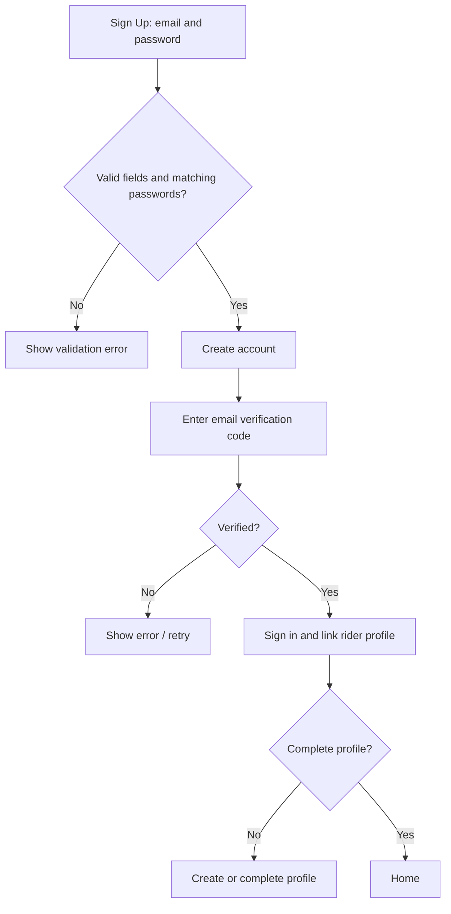
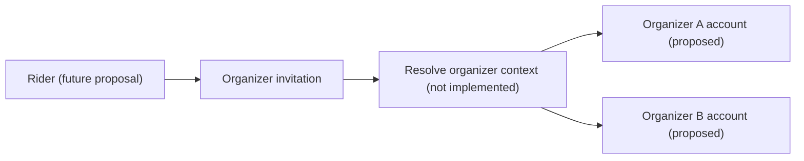

# Authentication and sign-up design

_Last updated: 2026-09-29_

`AuthContext` uses Amplify Auth with the backend-owned rider pool. In the default single-organizer build, `src/config/subscription.config.ts` reads the configured pool and API endpoint at startup. `AuthNavigator` exposes Login, Sign Up, Forgot Password and Enforced Password Change. Sign-up validates email and password, confirms the email code, then links an existing profile if possible; `AppNavigator` routes missing/incomplete profiles to Profile Creation.

On login, a forced new-password challenge opens the enforced change screen; the forgotten-password flow requests a code and confirms a new password. Signed-in riders use Change Password for a voluntary change. Credentials and pool settings must never be hardcoded in documentation or source. The backend [deployment guide](https://github.com/kvijay77-in/tour-data-api/blob/main/docs/guides/deployment.md) owns pool setup.

## Historical proposal, not an implemented flow

The former sign-up approach proposed invitations to discover an organizer and switch between organizer-specific accounts. The app configuration defines a multi-organizer mode, but invitation discovery and account switching are not integrated into the current screens. They are **not requirements of the deployed rider experience**.

For current permissions use the backend [RBAC source](https://github.com/kvijay77-in/tour-data-api/blob/main/src/layers/common/rbac.py); do not create app-local role names.
