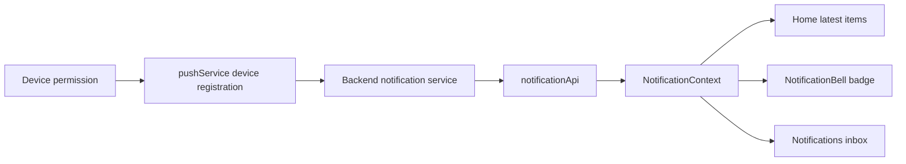

# Notifications design

_Last updated: 2026-09-29_

`NotificationProvider` is the source for the inbox, unread badge and latest Home items; `useNotifications` exposes it to `NotificationBell`, `HomeScreen` and `NotificationsScreen`. The service reads notifications and unread counts through the shared authenticated client and marks all as read. If notification endpoints are unavailable (404/501), the context hides the badge without a noisy error.

On supported devices, `pushService` requests notification permission and registers a device with the backend. Push is not required to view the inbox. The backend owns targeting, storage and delivery behavior; consult the [API reference](https://github.com/kvijay77-in/tour-data-api/blob/main/docs/design/api-reference.md).

