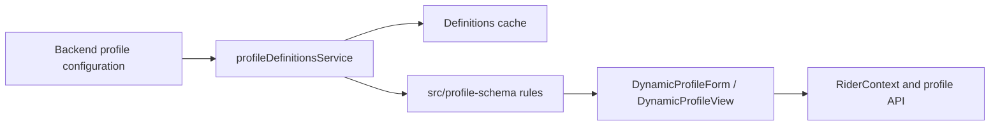

# Dynamic profile schema

_Last updated: 2026-09-29_

`RiderContext` loads profile definitions from backend configuration using `profileDefinitionsService`, which caches the last successful definitions in `profileConfigStore`. On a failed refresh, the definitions cache can be used to render the form; saving a profile remains an online operation. `src/profile-schema/` implements the rules, not a fixed list of rider fields:

| Module | Responsibility |
| --- | --- |
| `types.ts`, `definitions.ts` | Definition types and normalized backend configuration |
| `bindings.ts`, `handlers.ts` | Bind profile values to form inputs and handle changes |
| `options.ts`, `visibility.ts` | Choice lists and conditional visibility |
| `validation.ts`, `payload.ts` | Validate required values and construct updates |
| `index.ts` | Public exports |

`DynamicProfileForm` and `DynamicProfileView` render the configured fields; `SearchableSelectField` supports selection. `ProfileCreationScreen` and `ProfileScreen` use them, and `ProfilePicture` supports choosing/displaying a photo. `RiderContext` requests picture upload and download URLs and applies the profile gate until required values are complete.

See [profile requirements](../requirements/profile.md) and the backend [API reference](https://github.com/kvijay77-in/tour-data-api/blob/main/docs/design/api-reference.md).
