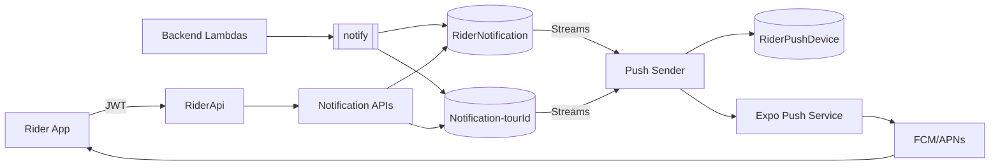

# Notification Design Reference

[← Back to docs index](./docs-index.md)

This document summarizes the approved notification framework for **tour-rider-app**. The full source of truth is in the backend repository:

- Backend design: `kvijay77-in/tour-data-api/docs/notification-framework-design.md`

## End-to-end flow

## Rider app implementation notes

- Targeting is by `profileId`; riders do **not** need to be registered to a tour to receive profile-targeted notifications.
- Push is the primary delivery path; inbox (`GET /v1/notifications`) is the source of truth.
- Push tokens are **not treated as app secrets**; no new `EXPO_PUBLIC` token variable is added.
- Expo access token stays only in backend SSM (not in this app).
- `projectId` for `getExpoPushTokenAsync` is read from `app.json` at `expo.extra.eas.projectId`.
- Web platform uses bell + inbox (no push registration).

## API contract used by this app

- `POST /v1/notifications/devices` `{ token, platform: 'ios'|'android' }`
- `DELETE /v1/notifications/devices/{token}`
- `GET /v1/notifications?since=<ISO>&limit=<n>`
- `GET /v1/notifications/unread-count`
- `PUT /v1/notifications/read` `{ readAt? }`

For pre-deployment environments returning `404`/`501`, this app hides notification badge counts and avoids noisy error logging.
