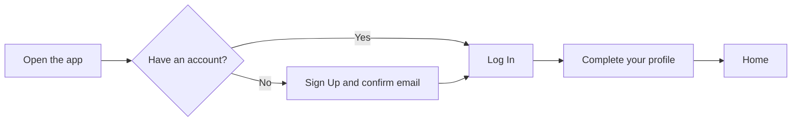

# Rider's guide

_Last updated: 2026-10-01_

Welcome! This guide helps you find your way around the rider app on iOS and Android. If you help test the app, you may have two apps installed: **Tour Rider (Test)** shows an orange **TEST** strip at the top of every screen and uses test data only, while **Tour Rider** is the live app for the real tour. Your tour organizer can tell you where to get the app and which account to use.

## Get the app and sign in

Get the app link from your organizer. Open it, choose **Sign Up** if you need a new account, enter your email address and a password, then enter the confirmation code sent to your email. If your organizer already created an account for you, choose **Log In** instead.

Sign in with your email and password. If you were given a temporary password, the app asks you to set a new one before you can continue. If you cannot remember your password, tap **Forgot Password**, request a code by email, and enter it with your new password. Once signed in, use **Change Password** in the menu to change it using your current password.

> 📸 **Screenshot:** Login and sign-up

## Complete your profile

If your profile is missing or needs more information, the app opens the profile form before Home. Fill in the fields marked as required and save. The fields you see may vary. Open **View Profile** from the menu or tap your profile card on Home to see or update your details. You can choose a profile picture from your photo library; allow photo access when prompted.

> 📸 **Screenshot:** Profile creation and profile picture

## Home and your tours

Home shows your profile card, a **Tour** card, a **Training Challenge** card and your latest notifications. When you are enrolled on the active tour and a ride is scheduled for today, Home also shows the **Today's ride check-in** panel. Tap **Tour** or choose it from the menu to see your current tour, if available, and previously listed tours. Use the tour selector to find a tour, then tap a ride to see its details. If you have not been enrolled, you may see “No tours available right now” or no active tour.

The ride details show the planned route, distance, expected times and stages such as **Start**, **Pit Stop** and **Finish**. When your organizer uploads a tour elevation image, it appears above the selected tour's ride list. Home's Tour and Training Challenge images also come from the active tour's uploads. Images require an internet connection; use **Retry** if loading fails. A historical tour can also be selected to view its rides and available tour elevation image.

For a registered ride, the app checks whether your check-in history has records when you open the ride. With records, choose **Ride info** or **Check-In**. Without records, the ride opens directly to **Ride info**; the check-in status affordance explains that no records are currently available. Unregistered rides open directly to Ride info.

> 📸 **Screenshot:** Home and tour selector
>
> 📸 **Screenshot:** Ride details and tour elevation

### Tour details and registration

Tour browsing, a separate tour-details page and a registration form have been built, but are **not reachable from the current menu**. If your organizer opens these pages in a future app update, the registration form asks for your riding experience and optional medical or special requirements. Submitting it sends a request for organizer review; it is not an immediate confirmation. For now, contact your organizer about joining a tour.

### Tour dashboard

A tour dashboard page is **not reachable from the current menu**. Today's check-in actions are available from the Home panel and today's Check-In view when the active tour and organizer-configured permissions allow them. Personal statistics on the dashboard are a placeholder.

> 📸 **Screenshot:** Tour dashboard (when available)

## Check-in status and history

The Check-In view shows the selected ride's records at the Start, Pit Stops and Finish. **Not Checked In** means no check-in is recorded yet; **Checked In** means at least one is recorded; **Not Riding** means you are not riding that day; **Quit Riding** means you have stopped the current ride. A stage without a recorded check-in does not mean you have completed that stage. Records made by tour staff show their staff method; permitted rider-created records show **Self**. Missing, empty or not-yet-available history is not an error. For today's ride only, the view may also show stage check-in, **Not Riding**, or **Quit Riding** actions based on the live ride and permissions set by the organizers. Confirm each action before it is sent. You can cancel your own eligible stage or Not Riding check-in and then check in again; records made by staff can also be cancelled when they belong to you and the permission remains active. For a missing or incorrect check-in, speak to tour staff.

### Quit Riding safely

> **Organisers' advice:** Wherever possible, quit at a Pit Stop so the team can record it for you and arrange safe transport for you and your bike. If you must quit on the road, contact the organisers immediately after confirming.
>
> **This cannot be undone from the app.** Only the organisers can cancel a Quit Riding check-in, after making sure you are safe to continue.

After Quit Riding is recorded, the app hides the other check-in actions. Contact the organisers if you need to resume riding; they must first make sure it is safe.

> 📸 **Screenshot:** Check-in status and ride history (when available)

## Events

Choose **Events** from the menu to see events grouped by tour, with your active tour first. Each event shows its type, location and whether registration is required. Open an event to see its activities and scheduled occurrences.

When registration is required, each occurrence shows whether you are registered. You can **Register** or **Un-register** only while the occurrence is **Planned**. When registration is not enabled, all tour riders participate. For an **Active** occurrence, the app shows each activity as **Pending**, **Complete** or **Opted out**. Where the organizers allow self-service, you can mark an activity complete, select a required option, or opt out when that activity permits it. Your own self-service records are labelled **Self**. You can cancel an eligible record and repeat the activity after the refreshed status allows it. The event team may need to resolve sequence or prerequisite restrictions.

Event participation requires an internet connection. Baggage handling and baggage reconciliation are staff functions and are not available in the rider app.

## Tour and ride documents

When a tour or ride has documents, a **Documents** section appears on the Tour or Ride Details screen. If there are no documents, the section is hidden. Each item shows its title, filename and available file details. Tap the file button to download it; the app shows transfer progress, saves it in its private document storage, and opens the system share/view sheet so you can choose an available viewer. No public storage permission is needed. The app requests a fresh download link each time and retries once if a transfer fails. You need an internet connection.

The Tour Documents section includes the **Rider docket** when uploaded by your organizer, along with other available tour files. Downloads are not limited to PDF files; viewing a file requires an app that supports its format.

## Notifications and training

Home shows your latest notifications. Tap **Open notifications inbox**, the bell at the top, or **Notifications** in the menu to see more. Opening the inbox marks notifications as read. On a phone you may be asked for permission to show alerts; you can still read the inbox if you decline. If there is nothing new, the inbox may be empty.

The **Training Challenge** card and menu item open a “Coming soon” page. Tracking your training in the app is not available yet.

> 📸 **Screenshot:** Notifications inbox and Training Challenge

## Menu and sign out

Open the menu to find **Home**, **View Profile**, **Notifications**, **Training Challenge**, **Tour**, **Events** and **Change Password**. Use **Log out** in the menu or the sign-out icon in the top bar when you are finished, especially on a shared device.

> 📸 **Screenshot:** Drawer menu

## Delete your account

Open **View Profile** from the menu, scroll to the bottom and tap **Delete my account**. Read the warning and tap **Continue**. Enter your password and tap **Delete**. You need an internet connection; if you are offline, the app says "You need to be online to delete your account" and nothing is changed. When deletion is complete, you are returned to the login screen with "Your account has been deleted", and you can no longer sign in with that email and password.

Deleting your account removes your sign-in only. Your tour records held by your organizer are not removed; contact your organizer to ask for those to be deleted. If you use both the Test and the live app, delete the account in each app separately.

> 📸 **Screenshot:** Delete my account

## Questions and quick fixes

**I didn't receive my confirmation or reset code.** Check your spam folder and confirm that you entered the correct email address. Try again later or contact your organizer.

**I can't get past the profile form.** Complete every required field and check any message shown beside a field. Try again when you have a connection.

**I cannot see my tour or rides.** Make sure you are signed into the right account and ask your organizer whether your place has been confirmed. You can pull down to refresh the Tour page.

**A page is empty or won't load.** Check your connection and pull down to refresh where available. If the problem continues, contact your organizer.

**Where are tour registration and today's dashboard?** Those pages aren't in the current menu. Today's check-in actions appear on Home or in the Check-In view only when you are enrolled on the active tour and the organizers' current ride settings allow them.
