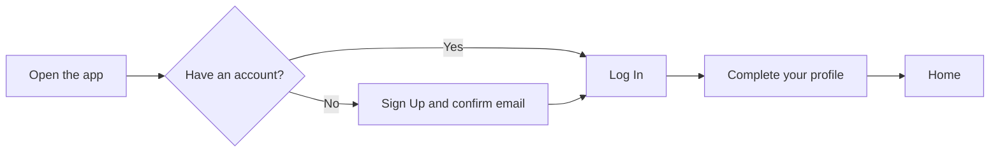

# Rider's guide

_Last updated: 2026-09-29_

Welcome! This guide helps you find your way around the rider app. Your tour organizer can tell you where to get the app and which account to use. Some tour-day views described below are being prepared and may not appear in the menu yet.

## Get the app and sign in

Get the app or website link from your organizer. Open it, choose **Sign Up** if you need a new account, enter your email address and a password, then enter the confirmation code sent to your email. If your organizer already created an account for you, choose **Log In** instead.

Sign in with your email and password. If you were given a temporary password, the app asks you to set a new one before you can continue. If you cannot remember your password, tap **Forgot Password**, request a code by email, and enter it with your new password. Once signed in, use **Change Password** in the menu to change it using your current password.

> 📸 **Screenshot:** Login and sign-up

## Complete your profile

If your profile is missing or needs more information, the app opens the profile form before Home. Fill in the fields marked as required and save. The fields you see may vary. Open **View Profile** from the menu or tap your profile card on Home to see or update your details. You can choose or take a profile picture there; allow photo or camera access when prompted.

> 📸 **Screenshot:** Profile creation and profile picture

## Home and your tours

Home shows your profile card, a **Tour** card, a **Training Challenge** card and your latest notifications. Tap **Tour** or choose it from the menu to see your current tour, if available, and previously listed tours. Use the tour selector to find a tour, then tap a ride to see its details. If you have not been enrolled, you may see “No tours available right now” or no active tour.

The ride details show the planned route, distance and stages such as **Start**, **Pit Stop** and **Finish**. Elevation information appears when available for that ride. A historical tour can also be selected to view its rides.

> 📸 **Screenshot:** Home and tour selector
>
> 📸 **Screenshot:** Ride details, ride plan and elevation

### Tour details and registration

Tour browsing, a separate tour-details page and a registration form have been built, but are **not reachable from the current menu**. If your organizer opens these pages in a future app update, the registration form asks for your riding experience and optional medical or special requirements. Submitting it sends a request for organizer review; it is not an immediate confirmation. For now, contact your organizer about joining a tour.

### Tour dashboard

A tour dashboard page has been built but is **not reachable from the current menu**. It previews today's ride and has **Not Riding Today** and **Quit Riding** actions, which require confirmation. Personal statistics there are a placeholder. Ask your organizer how to report a change in riding plans with the current app.

> 📸 **Screenshot:** Tour dashboard (when available)

## Check-in status and history

Check-in views are **not reachable from the current menu**. When these views become available, today's progress will show check-ins at the Start, Pit Stops and Finish; the history page lists rides and lets you inspect a ride. **Not Checked In** means no check-in is recorded yet; **Checked In** means at least one is recorded; **Not Riding** means you are not riding that day; **Quit Riding** means you have stopped the current ride. A stage without a recorded check-in does not mean you have completed that stage. For a missing or incorrect check-in, speak to tour staff.

> 📸 **Screenshot:** Check-in status and ride history (when available)

## Notifications and training

Home shows your latest notifications. Tap **Open notifications inbox**, the bell at the top, or **Notifications** in the menu to see more. Opening the inbox marks notifications as read. On a phone you may be asked for permission to show alerts; you can still read the inbox if you decline. If there is nothing new, the inbox may be empty.

The **Training Challenge** card and menu item open a “Coming soon” page. Tracking your training in the app is not available yet.

> 📸 **Screenshot:** Notifications inbox and Training Challenge

## Menu and sign out

Open the menu to find **Home**, **View Profile**, **Notifications**, **Training Challenge**, **Tour** and **Change Password**. Use **Log out** in the menu or the sign-out icon in the top bar when you are finished, especially on a shared device.

> 📸 **Screenshot:** Drawer menu

## Questions and quick fixes

**I didn't receive my confirmation or reset code.** Check your spam folder and confirm that you entered the correct email address. Try again later or contact your organizer.

**I can't get past the profile form.** Complete every required field and check any message shown beside a field. Try again when you have a connection.

**I cannot see my tour or rides.** Make sure you are signed into the right account and ask your organizer whether your place has been confirmed. You can pull down to refresh the Tour page.

**A page is empty or won't load.** Check your connection and pull down to refresh where available. If the problem continues, contact your organizer.

**Where are registration, check-ins or today's dashboard?** Those pages aren't in the current menu. Your organizer can help until a future app update makes them available.
